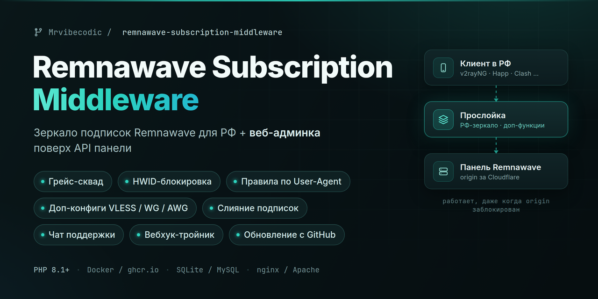

  

<h1 align="center">Remnawave Subscription Middleware</h1>

  Прослойка подписки для панели <a href="https://remna.st">Remnawave</a>: встаёт на домен подписки вместо панели или работает зеркалом подписки на своём домене.

  <a href="https://mrvibecodic.github.io/subm/"><b>Документация</b></a> (наполняется)
  ·
  <a href="https://t.me/+2lmP1yhxpCE3MDcy"><b>Группа</b></a> — новости и релизы
  ·
  <a href="https://t.me/+8BJQXYXYLqM4YWYy"><b>Чат</b></a> — вопросы и помощь

  
  
  
  

---

## О проекте

Прослойка забирает подписку у панели, применяет свои правила и отдаёт ответ VPN-клиенту. Ссылки у пользователей остаются прежними, если она стоит на домене подписки, или выдаются новые на домене зеркала. В комплекте идёт веб-админка поверх API панели.

* **Зеркало подписок** — клиенты ходят на ваш домен, даже если домен панели у них не открывается.
* **Грейс вместо отключения** — истёкший пользователь на время попадает в ограниченный сквад.
* **Блокировка устройств по HWID**, лог запросов, сессии и аномалии по IP.
* **Доп. конфиги по сквадам** — WireGuard, AmneziaWG до 3.1, VLESS — и слияние двух подписок в одну ссылку.
* **Админка** — пользователи, устройства, логи, брендинг, чат поддержки, пересылка вебхуков.
* **Для [Clod Clash](https://github.com/Mrvibecodic/clod-clash)** — защищённый канал подписки и статистика узлов; [приложение для Android](https://github.com/Mrvibecodic/submw-android) с уведомлениями.

## Стек

* PHP 8.1+ без фреймворков и сторонних зависимостей.
* Docker-образ `ghcr.io/mrvibecodic/remnawave-subscription-middleware` (nginx + PHP-FPM): `v1` — стабильный, `dev` — тестовый. Без Docker — любой хостинг с PHP, Apache или nginx.
* База данных: SQLite по умолчанию, MySQL / MariaDB по выбору.
* Панель Remnawave 2.7.4+ и 3.x — через её API и вебхуки.

## Установка

Готовые `docker-compose.yml` лежат в [`docker/`](docker): рядом с панелью, на отдельном сервере со своим реверс-прокси, с Caddy или nginx и автосертификатом, с MariaDB. После запуска прослойка ведёт через мастер установки в браузере. Пошагово — в [документации](https://mrvibecodic.github.io/subm/).

> [!WARNING]
> Проект в стадии beta. Возможны ошибки. Перед установкой сделайте резервную копию панели.

Подробное описание возможностей, пока оно переезжает в документацию, — в [docs/README-full.md](docs/README-full.md).
